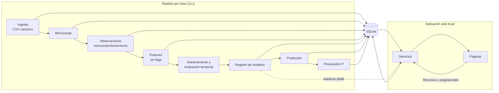
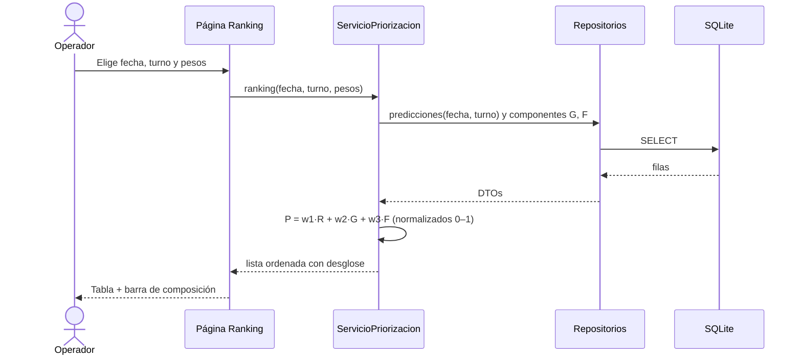

# Entregable UX/UI y system design

Autor: diseñador UX/UI del equipo. Destinatario: líder técnico (Fase 3).
Este documento es el acuerdo de diseño. Si la implementación necesita desviarse, el líder técnico lo registra como ADR en `03_codigo/docs/adr/` con el motivo.

---

## 1. Usuario y tarea principal

**Usuario:** operador o analista del área de seguridad ciudadana de la municipalidad (Centro de Control de Operaciones). Usa una computadora de escritorio, conoce el distrito por sectores y calles, no es técnico en ML.

**Tarea principal:** antes de cada turno, decidir en qué microzonas reforzar la presencia preventiva con recursos limitados.

**Preguntas que la interfaz debe responder, en este orden:**
1. ¿Qué zonas conviene priorizar en el próximo turno? → Ranking
2. ¿Dónde están? → Mapa
3. ¿Por qué esa zona tiene esa prioridad? → Ficha de detalle
4. ¿Cómo viene el distrito en general? → Tablero
5. ¿Qué recursos tengo y dónde los asigno? → Recursos (segundo nivel)
6. ¿Qué tan confiable es esto? → Metodología

**Principios:**
- **Apoyo, no veredicto.** El sistema sugiere; el operador decide. Ningún texto afirma que una zona "es peligrosa".
- **Explicable.** Toda prioridad se descompone en sus tres componentes (nivel estimado R, gravedad G, frecuencia F) con los pesos vigentes.
- **Sin estigmatizar.** Los niveles describen registros del CCO en un periodo, no la condición de un barrio. El aviso es visible en mapa y ranking, no escondido.
- **Honesto con la incertidumbre.** Se muestra la fecha de corte de los datos, el modelo vigente y su Macro F1.

---

## 2. Arquitectura de información y navegación

App multipágina (barra lateral). Controles globales en la barra lateral, persistentes entre páginas (estado de sesión):

- **Fecha** objetivo (por defecto: el día siguiente al último dato disponible).
- **Turno**: Mañana / Tarde / Noche (por defecto: el siguiente turno).
- **Pesos de prioridad** w1 (R), w2 (G), w3 (F): tres deslizadores 0–1, normalizados para sumar 1; se muestra la suma normalizada. Botón "Restablecer pesos" a los valores de `config`.
- Pie de la barra lateral: "Datos hasta: {fecha_corte} · Modelo: {nombre} v{versión} · Macro F1 (prueba): {valor}".

Páginas:

| # | Página | Propósito |
|---|---|---|
| 0 | Inicio | Qué es, cómo usarlo, aviso de uso responsable, accesos a las demás páginas |
| 1 | Ranking | Lista ordenada de microzonas por prioridad P para fecha/turno |
| 2 | Mapa | Microzonas coloreadas por nivel estimado; clic → ficha |
| 3 | Detalle de microzona | Ficha explicable de una microzona |
| 4 | Tablero | Panorama histórico y desempeño del modelo |
| 5 | Recursos (nivel 2) | Registrar disponibilidad y asignar a microzonas |
| 6 | Metodología | Datos, modelo, métricas, limitaciones (model card y data card) |

---

## 3. Pantallas

### 3.0 Inicio
```
┌───────────────────────────────────────────────────────────────┐
│ Priorización preventiva — {Distrito}                          │
│ Apoyo a la decisión de patrullaje a partir de registros del   │
│ CCO. Datos hasta {fecha_corte}.                               │
│ ┌ Aviso ───────────────────────────────────────────────────┐  │
│ │ Los niveles reflejan incidencias registradas, no delitos │  │
│ │ ni una condición permanente de la zona. La decisión      │  │
│ │ final es del operador.                                    │  │
│ └───────────────────────────────────────────────────────────┘  │
│ [Ver ranking del próximo turno]   [Abrir mapa]                │
│ Cómo leer: R · G · F  (tres tarjetas con una frase cada una)  │
└───────────────────────────────────────────────────────────────┘
```

### 3.1 Ranking
```
┌ KPIs ────────────────────────────────────────────────────────┐
│ Microzonas evaluadas │ En nivel Alto │ Fecha · Turno          │
└──────────────────────────────────────────────────────────────┘
Aviso de uso responsable (una línea, ícono de información)
Mostrar top [10 ▾]   Filtrar por sector [Todos ▾]   [Descargar CSV]
┌────┬──────────┬────────┬───────┬──────────────────────┬───────┐
│ #  │Microzona │ Sector │ Nivel │ Composición de P     │  P    │
├────┼──────────┼────────┼───────┼──────────────────────┼───────┤
│ 1  │ MZ-0142  │ II     │ Alto  │ ███R ██G █F          │ 0,82  │
└────┴──────────┴────────┴───────┴──────────────────────┴───────┘
Clic en fila → Detalle de microzona.
```
- "Composición de P": barra apilada horizontal con w1·R, w2·G, w3·F (mismos tres colores en toda la app).
- Nivel siempre como texto + color (nunca solo color).
- El sector es referencial; si falta, "Sin sector".

### 3.2 Mapa
- Mapa base OpenStreetMap con atribución visible ("© colaboradores de OpenStreetMap").
- Límite distrital como contorno.
- Microzonas como polígonos rellenos por **nivel estimado** (paleta §4.2), opacidad 0,55, borde fino.
- Las 10 primeras del ranking llevan su número de posición como etiqueta.
- Tooltip: microzona, nivel, P, sector.
- Clic: abre la ficha (o fija la microzona seleccionada y ofrece "Ver detalle").
- Leyenda: Bajo / Medio / Alto + "Sin registros en el periodo" (gris claro).
- Interruptor de capa opcional: "Incidencias históricas (puntos)" desactivado por defecto.
- Aviso de uso responsable bajo el mapa.

### 3.3 Detalle de microzona
```
MZ-0142 · Sector II · Nivel estimado: Alto · Prioridad P = 0,82 (#1 de N)
┌ ¿Por qué esta prioridad? ─────────────────────────────────────┐
│ R (nivel estimado) 0,90 × w1 0,50 = 0,45                     │
│ G (gravedad histórica) 0,70 × w2 0,30 = 0,21                 │
│ F (frecuencia reciente) 0,80 × w3 0,20 = 0,16                │
│ Probabilidades del modelo: Bajo 0,10 · Medio 0,25 · Alto 0,65│
└───────────────────────────────────────────────────────────────┘
[Serie: incidencias por día en la microzona, últimas semanas]
[Barras: incidencias por turno]   [Barras: tipos más frecuentes]
[Tabla: últimas 20 incidencias — fecha, hora, turno, tipo, subtipo]
```
- Sin datos personales; la dirección solo si la fuente la publica, truncada a calle.

### 3.4 Tablero
- KPIs: total de incidencias, promedio diario, % sin sector, días cubiertos.
- Serie diaria total con marca de la división entrenamiento / validación / prueba.
- Mapa de calor día de la semana × turno.
- Barras horizontales por tipo de incidencia (ordenadas).
- Curva de concentración (% de microzonas vs % de incidencias) — evidencia de HE2.
- Desempeño: tabla Macro F1 de los cuatro modelos (validación y prueba) y matriz de confusión del modelo vigente.
- Importancia de variables del modelo vigente (evidencia de HE1).

### 3.5 Recursos (segundo nivel)
- Banner fijo: "Datos ilustrativos ingresados manualmente; no provienen de la municipalidad."
- Formulario de disponibilidad por fecha y turno: tipo de recurso (camioneta, motocicleta, a pie, otro) y cantidad.
- Asignación: elegir microzona (por defecto, las primeras del ranking), tipo y cantidad.
- Validación: no se puede asignar más de lo disponible por tipo/fecha/turno. Mensaje: "Solo quedan {n} {tipo} disponibles para este turno."
- Tabla de asignaciones del turno con opción de quitar.

### 3.6 Metodología
- Fuente de datos, periodo, registros, licencia.
- Definición de microzona, de nivel (umbrales), de R, G, F y de la fórmula P.
- Partición temporal y métricas por modelo.
- Limitaciones (tomadas del alcance y de los informes de Fase 1 y 2).
- Enlaces a `docs/model_card.md` y `docs/data_card.md`.

### 3.7 Estados de interfaz (todas las páginas)
| Estado | Comportamiento |
|---|---|
| Cargando | Indicador con texto ("Calculando ranking…") |
| Sin base de datos o sin pipeline ejecutado | Mensaje con el comando exacto a ejecutar |
| Sin predicciones para la fecha/turno | "No hay estimaciones para {fecha} {turno}. Fechas disponibles: …" |
| Sin resultados por filtro | "Ningún resultado con estos filtros." + botón limpiar |
| Error | Mensaje en lenguaje llano + detalle técnico plegable |

---

## 4. Design system

### 4.1 Tokens
| Token | Valor | Uso |
|---|---|---|
| `color.primario` | `#1F4E79` | Encabezados, botones primarios |
| `color.texto` | `#1A1A1A` | Texto |
| `color.texto_secundario` | `#5A5A5A` | Notas, fuentes |
| `color.fondo` | `#FFFFFF` | Fondo |
| `color.fondo_secundario` | `#F3F5F8` | Barra lateral, tarjetas |
| `color.aviso_fondo` | `#EAF2FB` | Caja de aviso de uso responsable |
| `color.error` | `#B3261E` | Solo errores de sistema, nunca niveles |
| `color.sin_datos` | `#D9D9D9` | Microzonas sin registros |
| `fuente` | sans-serif del sistema | Todo |
| `radio` | 6 px | Tarjetas |
| `espaciado` | múltiplos de 8 px | Márgenes |

### 4.2 Escala de niveles (ordinal, apta para daltonismo, deliberadamente no alarmista)
| Nivel | Color | Texto sobre el color |
|---|---|---|
| Bajo | `#DADAEB` | `#1A1A1A` |
| Medio | `#9E9AC8` | `#1A1A1A` |
| Alto | `#54278F` | `#FFFFFF` |

No usar rojo/verde para niveles: el rojo comunica peligro y refuerza el estigma.

### 4.3 Componentes de P (iguales en toda la app)
| Componente | Color |
|---|---|
| R — nivel estimado | `#1F4E79` |
| G — gravedad histórica | `#6A8EAE` |
| F — frecuencia reciente | `#B7C9D9` |

### 4.4 Gráficos
- Título que dice el hallazgo, ejes con unidades, fuente al pie ("Fuente: elaboración propia a partir de {fuente}").
- Números con coma decimal y espacio de miles.
- Una sola paleta en todo el sistema (los tokens anteriores); tema de Plotly configurado una vez.

### 4.5 Accesibilidad
- Contraste mínimo WCAG AA (4,5:1 texto normal).
- Nivel siempre acompañado de texto.
- Todos los controles con etiqueta visible.
- Tablas con encabezados; gráficos con un resumen textual debajo.

### 4.6 Microcopy
- "Nivel estimado", no "riesgo" ni "peligrosidad".
- "Incidencias registradas", no "delitos".
- "Prioridad sugerida", no "zona crítica" en títulos.
- Aviso estándar: "Los niveles reflejan incidencias registradas por el CCO en el periodo analizado, no delitos ni una condición permanente de la zona. Úselos como apoyo; la decisión final es del operador."

---

## 5. System design

### 5.1 Principios
- **Local y reproducible:** todo corre en una PC sin GPU, sin servicios externos (salvo las teselas del mapa base).
- **Lote fuera de línea, consulta en línea:** el pipeline (ingesta → microzonas → features → entrenamiento → predicción → ranking) se ejecuta por comando y escribe en SQLite. La interfaz **solo lee** de SQLite y del modelo registrado; nunca entrena.
- **Capas:** interfaz → servicios → dominio → repositorios → SQLite. La interfaz no ejecuta SQL ni toca pandas de datos crudos.
- **Configuración externa:** rutas, tamaño de microzona, pesos por defecto, semillas y umbrales en un archivo de configuración, no en el código.

### 5.2 Componentes


### 5.3 Flujo de consulta del operador


### 5.4 Modelo de datos (mínimo; el líder técnico puede ampliarlo con ADR)
```mermaid
erDiagram
  fuente_datos ||--o{ incidencia : origina
  tipo_incidencia ||--o{ incidencia : clasifica
  microzona ||--o{ incidencia : contiene
  microzona ||--o{ observacion : agrega
  observacion ||--o{ feature : describe
  modelo ||--o{ prediccion : genera
  microzona ||--o{ prediccion : recibe
  prediccion ||--|| prioridad : prioriza
  recurso_disponible ||--o{ asignacion : se_asigna
  microzona ||--o{ asignacion : recibe
  ejecucion_pipeline ||--o{ modelo : produce

  fuente_datos { text id PK; text nombre; text url; text licencia; text sha256; text fecha_descarga }
  tipo_incidencia { int id PK; text tipo; text subtipo; real gravedad }
  incidencia { text id PK; text fuente_id FK; int tipo_id FK; text microzona_id FK; text fecha; text hora; text turno; real lat; real lon; text sector }
  microzona { text id PK; text geojson; real centro_lat; real centro_lon; text sector_ref; int activa }
  observacion { int id PK; text microzona_id FK; text fecha; text turno; int conteo; text nivel; text particion }
  feature { int observacion_id FK; text nombre; real valor }
  modelo { int id PK; text nombre; text version; text hiperparametros; real macro_f1_valid; real macro_f1_test; text ruta_artefacto; int vigente; text creado }
  prediccion { int id PK; int modelo_id FK; text microzona_id FK; text fecha; text turno; text nivel; real p_bajo; real p_medio; real p_alto }
  prioridad { int prediccion_id FK; real r; real g; real f; real w1; real w2; real w3; real p; int posicion }
  recurso_disponible { int id PK; text fecha; text turno; text tipo; int cantidad }
  asignacion { int id PK; int recurso_id FK; text microzona_id FK; int cantidad; text creado }
  ejecucion_pipeline { int id PK; text inicio; text fin; text estado; text detalle }
```
Restricciones clave: `UNIQUE(microzona_id, fecha, turno)` en `observacion`; `CHECK(turno IN ('Mañana','Tarde','Noche'))`; `CHECK(cantidad >= 0)`; suma de asignaciones ≤ cantidad disponible (validado en servicio y cubierto por test). `PRAGMA foreign_keys = ON`.

### 5.5 Requisitos no funcionales
| Requisito | Meta |
|---|---|
| Arranque de la app | < 10 s en PC convencional |
| Cambio de fecha/turno/pesos | < 2 s |
| Pipeline completo | < 5 min con el volumen actual |
| Reproducibilidad | Semillas fijas; mismo dato + misma config ⇒ mismas métricas |
| Portabilidad | Windows 10 con Python 3.10+, solo `pip` |
| Trazabilidad | Cada modelo guarda versión, datos (sha256), config y métricas |
