# Análisis exploratorio y preparación para el modelado

**Proyecto:** Sistema web basado en aprendizaje automático para la predicción espaciotemporal de puntos críticos y la priorización de recursos de patrullaje en San Juan de Miraflores (SJM), Lima.
**Entregable 1, Fase 2.** Fecha: 31 de octubre de 2026.
**Datos:** extracto del CCO de la MDSJM (2 592 incidencias registradas, del 16 de mayo al 10 de junio de 2026), límite distrital INEI y, como contexto, SIDPOL.
**Reproducción:** cuatro notebooks ejecutados con `RAIZ/.venv` (`notebooks/01_calidad` → `04_preparacion_modelado`). Cada cifra de este informe aparece en la salida de un notebook y en `datos/metricas_*.json`.

> En todo el documento se habla de **incidencias registradas** por el CCO, no de delitos. Solo el 2,0 % se clasifica como actividad presuntamente delictiva, y lo que se registra depende de dónde hay cámaras y patrullaje.

---

## 1. Resumen ejecutivo

1. Tras la limpieza quedan **2 580 incidencias** (se excluyen 12 puntos a más de 150 m del límite, 2 de ellos errores groseros). No hay duplicados y el turno coincide con la hora en el 100 % de los registros.
2. **Se excluyen como objetivo el arranque (16–21 may, 32,0 registros/día y sin turno Noche hasta el 20 may) y los días censurados (9–10 jun).** La ventana utilizable va del 22 de mayo al 8 de junio (18 días).
3. El aumento de cobertura del 32,7 % entre el 22–28 may y el 29 may–4 jun procede en un **88 % de las cámaras CECOP**. Lo más probable es un cambio en el esfuerzo de registro, pero la evidencia no es concluyente.
4. **Microzona: grilla de 500 m** (86 celdas activas). Es la única opción que cumple los cuatro criterios fijados de antemano (señal para tres niveles, tamaño de pocas cuadras, número manejable de celdas y cobertura).
5. **HE2 se sostiene (exploratorio):** el 14,0 % de las celdas acumula el 50 % de los registros y el 33,1 % acumula el 80 % (Gini 0,63). El resultado es estable entre periodos y tamaños.
6. **Objetivo:** Bajo = 0, Medio = 1 y Alto ≥ 2 incidencias por microzona-turno (b = 1, calculado con entrenamiento). En entrenamiento la distribución es 72,0 / 18,6 / 9,4 %.
7. **Partición:** entrenamiento del 22 al 31 de mayo, validación del 1 al 4 de junio y prueba del 5 al 8 de junio. La tabla tiene 4 644 filas (con ceros), 18 variables y supera la prueba programática de no fuga.
8. **Línea base de persistencia: Macro F1 = 0,439 en validación** ("siempre Bajo" obtiene 0,282). Es la marca que la Fase 3 debe superar.

---

## 2. Datos y calidad

### 2.1 Fuente y verificación

El CSV canónico de la Fase 1 (sha256 `eea9ec56…dbacd`, verificado al cargar) tiene 2 592 registros y 22 columnas. Fecha, hora, turno, tipo y coordenadas están completos. Solo faltan `sector` (543 registros, 20,9 %) y `zona` (312, 12,0 %), así que la ubicación se toma de las coordenadas. `ubigeo_inei` se lee como texto y vale `150133` en el 100 % de las filas (la fuente publica 150141, que en INEI corresponde a Surquillo).

### 2.2 Hallazgos de calidad y reglas aplicadas

| Aspecto | Evidencia | Decisión |
|---|---|---|
| Duplicados | 0 por ID y 0 por contenido (fecha-hora, coordenadas y modalidad) | Ninguna |
| Coordenadas fuera del límite | 32 puntos: 20 a ≤ 113 m del borde, 10 entre 287 m y 1,9 km y 2 errores groseros (Callao a 15 km y Áncash a 304 km) | Se conservan los de ≤ 150 m y se excluyen 12 (Figura 2) |
| Hora ↔ turno | Rangos observados: Mañana 06:06–13:59, Tarde 14:10–21:59, Noche 22:08–05:59; 0 inconsistencias | El turno Noche de una fecha reúne la madrugada y las 22–24 h de ese mismo día calendario |
| Catálogo | 7 tipos, 23 subtipos y 79 modalidades; erratas como "PREUNTOS", "CONTRA CONTRA" o "LLAMDA" | Se crean copias normalizadas (`tipo_corto`, `subtipo_norm`, `canal_norm`) |
| Columnas [POST] | `estado_final`, `fecha_hora_cierre`, `tiempo_respuesta_min` (y `NIVEL` en la fuente) | Se usan solo para diagnosticar la censura y no pasan al dataset limpio |

El detalle de cada regla, con su conteo, está en `reglas_limpieza.md`.

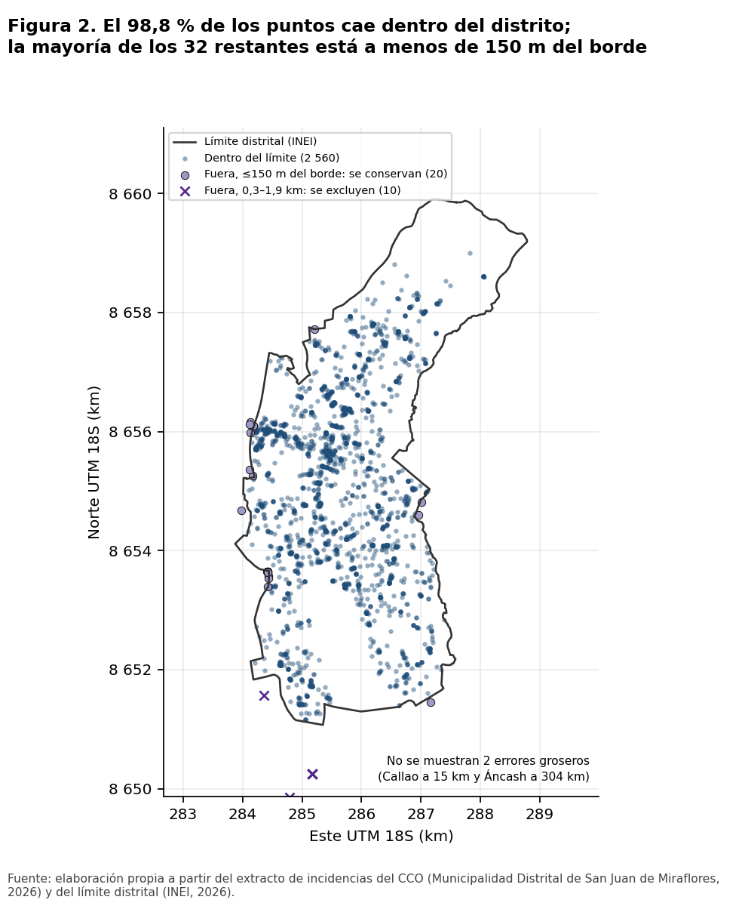

### 2.3 Arranque del registro (advertencia 2 de la Fase 1)

Del 16 al 21 de mayo se registran **32,0 incidencias/día**, frente a 114,7 del 22 al 31 de mayo. **No hay ningún registro en turno Noche entre el 16 y el 20 de mayo.** El 92 % proviene de cámaras y WhatsApp o llamada aportan solo 2,2 por día (después son 27,9). Es la huella de un sistema que se pone en marcha y cuyos canales y turnos se incorporan de forma escalonada, no una caída real de incidencias.
**Decisión:** esos días **no generan filas objetivo**, pero se conservan como **historial** para las variables rezagadas. Así, el 22 de mayo ya tiene una ventana previa de 6 días. Como contrapartida, los acumulados de las primeras fechas de entrenamiento quedan subestimados, y las variables de nivel del distrito (sección 6.4) ayudan a corregirlo.

### 2.4 Censura del final (advertencia 1 de la Fase 1)

El dataset solo publica incidencias cerradas. El último cierre observado es del **10 de junio a las 15:09**, y el cierre automático de las "No atendida" tarda una mediana de **1 443 min (~24 h)**. Por tanto, faltan las incidencias registradas aproximadamente **desde las 15:06 del 9 de junio** que seguían abiertas. Lo confirman los datos:

- El 9 de junio tiene **0 registros entre las 22:00 y las 23:59** (la media es 13,3), la tarde mermada (23 frente a una media de 30,6) y un 61,1 % de cierres de más de 23 h.
- El 10 de junio solo tiene turno Mañana (80 registros) y un 0 % de cierres de más de 23 h.
- El 8 de junio está completo: el P99 del tiempo de respuesta (1 522 min) termina antes del corte.

**Decisión:** se **excluyen el 9 y el 10 de junio** de la tabla de modelado. La prueba usa como último día el 8 de junio.

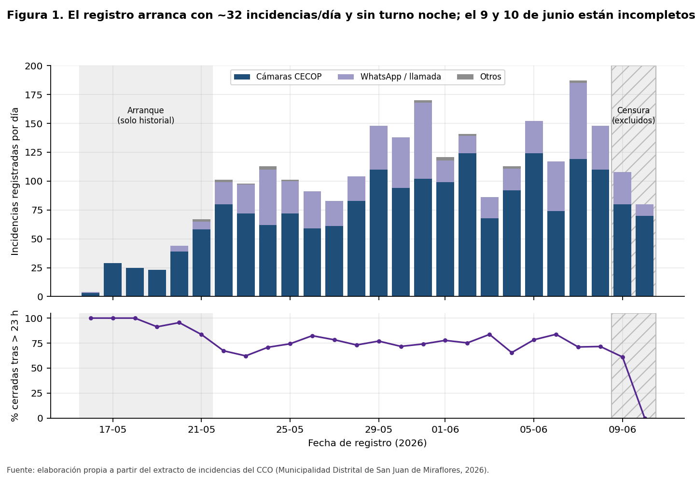

### 2.5 Cambio de cobertura (advertencia 3 de la Fase 1)

El alcance señala unos 84 registros/día en mayo frente a unos 125 en junio. Gran parte de esa diferencia la explica el arranque. Sin él, la comparación entre dos bloques de 7 días de la ventana estable da:

| Canal | 22–28 may (por día) | 29 may–4 jun (por día) | Cambio |
|---|---|---|---|
| Cámaras CECOP | 69,9 | 98,4 | +40,9 % |
| WhatsApp/llamada | 27,9 | 31,3 | +12,3 % |
| **Total** | **98,7** | **131,0** | **+32,7 %** |

El **88 % del aumento** proviene de las cámaras, mientras que los canales ciudadanos crecen mucho menos. Esto apunta a un cambio en el **esfuerzo de registro**. Sin embargo, los registros cuyo reportante es un contribuyente también suben un 34,4 %, así que no puede descartarse un aumento real parcial: **la evidencia no es concluyente**.
**Tratamiento:** (i) se añaden variables de nivel global del distrito rezagadas (`distrito_lag1`, `distrito_lag1_turno`, `distrito_media7`) para que el modelo pueda reescalar; (ii) se advierte de que la proporción de la clase Alto crece hacia el final del periodo (sección 6.2).

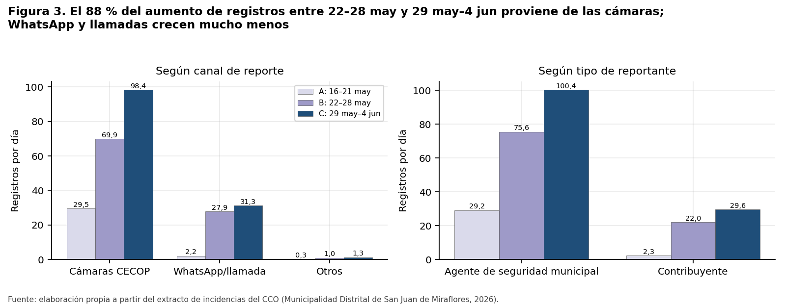

### 2.6 Sesgo de registro (advertencia 5 de la Fase 1)

El 74,5 % de los registros proviene de cámaras CECOP y el 77,9 % lo reporta un agente municipal. El 20,9 % no tiene sector. Por eso los datos describen **dónde y cuándo mira el CCO**. El sesgo se documenta y se tiene en cuenta en la interpretación de todos los resultados espaciales (secciones 4, 5 y 8).

---

## 3. Patrones temporales

Los patrones de esta sección se calculan con la ventana estable **sin prueba** (22 may – 4 jun, 14 días y 1 602 registros). La serie diaria muestra conteos de todos los días.

- **Nivel diario:** entre 83 y 169 incidencias por día (media de 114,4; coeficiente de variación de 0,22), con tendencia creciente ligada al cambio de cobertura (Figura 4).
- **Turno:** Mañana 44,6 %, Noche 31,2 % y Tarde 24,2 %. Los tres turnos duran 8 h, así que la diferencia es real en el registro.
- **Día × turno:** la Noche sube el fin de semana (49,2 registros por turno frente a 30,3 en días laborables; Figura 5). Cada combinación se observa solo **dos veces**, de modo que el efecto es exploratorio.
- **Hora:** hay picos a las 06–09 h (máximo a las 08 h, con 8,1 por hora) y hacia la medianoche. Los valles se dan de madrugada (05 h, con 1,5) y por la tarde (Figura 6).
- **Tipo:** presuntas infracciones 53,1 %, presuntas faltas 22,1 % y actividades presuntamente delictivas 2,3 % (como máximo 6 por día; Figura 7). Las clases del objetivo agregan todos los tipos, y la gravedad entra por separado (sección 6.3).
- **Autocorrelación:** en la celda de 500 m, el conteo se correlaciona con el total de la celda el día anterior (Spearman 0,34), con el mismo turno del día anterior (0,27) y con la misma fecha-turno de la semana previa (0,24). En el distrito, solo el rezago de 7 días sale de la banda de ±1,96/√n (0,69 con n = 14), lo que sugiere un ciclo semanal. Esto justifica los rezagos de 1 y 7 días y los acumulados móviles (Figura 8).

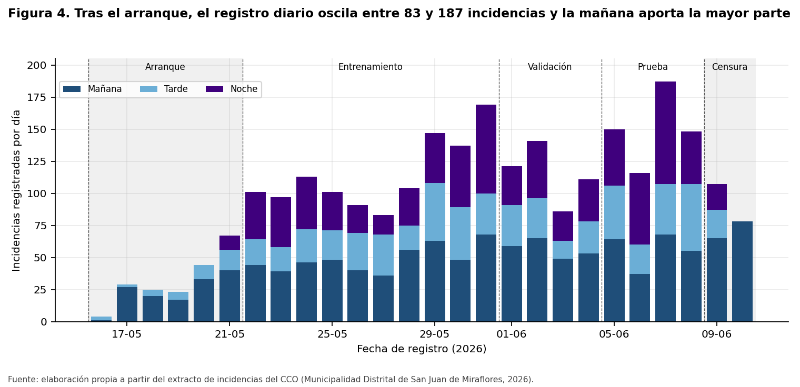

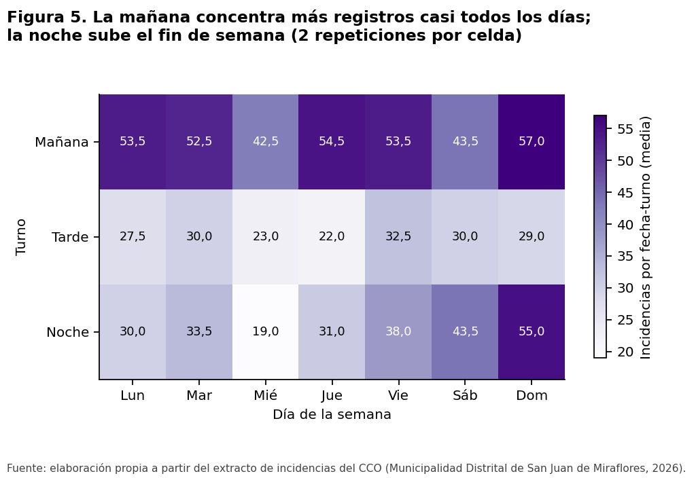

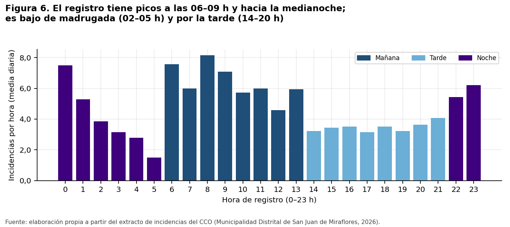

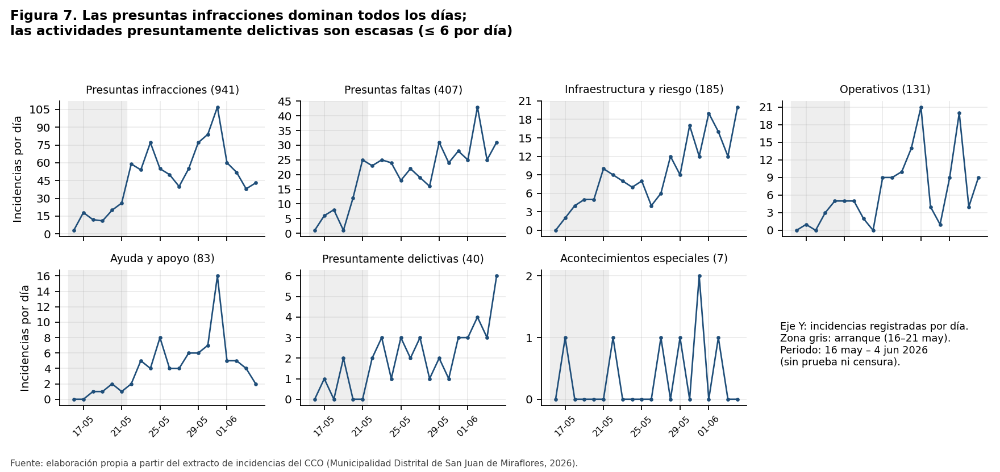

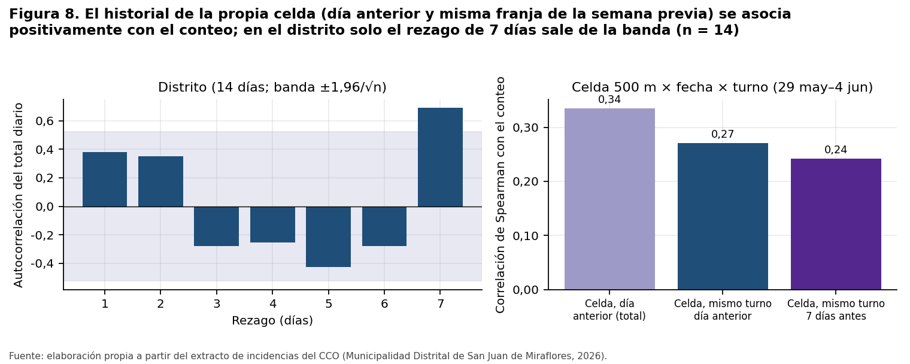

---

## 4. Patrones espaciales y elección de microzona

Se proyectó a UTM 18S (EPSG:32718) y se evaluaron grillas cuadradas de 300, 500, 750 y 1 000 m. H3 no se evaluó porque no forma parte del entorno del proyecto. Las **celdas activas** son las que intersecan el distrito y registran al menos 1 incidencia **en entrenamiento**. Los ceros se miden entre el 22 de mayo y el 4 de junio.

| Lado | Celdas en el distrito | Activas | % celda-turno con 0 | Media por celda-turno | Alto en train | Cobertura | Decisión |
|---|---|---|---|---|---|---|---|
| 300 m | 307 | 176 | 84,7 | 0,21 | 3,6 % | 98,1 % | Descartada: poca señal para Alto y demasiadas celdas |
| **500 m** | **121** | **86** | **72,4** | **0,44** | **9,4 %** | **99,5 %** | **Elegida** |
| 750 m | 64 | 45 | 58,1 | 0,85 | 19,7 % | 100,0 % | Descartada: celda de 0,56 km² |
| 1 000 m | 38 | 30 | 50,8 | 1,27 | 16,9 % | 99,9 % | Descartada: celda de 1 km² |

Los **criterios se fijaron antes de elegir**: (a) Alto ≥ 5 % y Medio ≥ 10 % de las celdas-turno de entrenamiento; (b) lado ≤ 500 m, unas 5 cuadras de ~100 m, del orden de un conjunto de manzanas; (c) entre 30 y 150 microzonas activas; (d) ≥ 95 % de los registros en celdas activas. **Solo la grilla de 500 m los cumple todos.** Las grillas de 750 y 1 000 m equilibran mejor las clases, pero una celda de 0,56 a 1 km² no orienta un patrullaje concreto.

La grilla elegida tiene **86 microzonas activas** (`MZ-0001`…`MZ-0086`, de norte a sur y de oeste a este) y su origen está en (283 500; 8 651 000). Cubre el 100 % de los registros de entrenamiento y el 98,3 % de los de validación. Se exporta en `datos/microzonas.geojson` (WGS84).

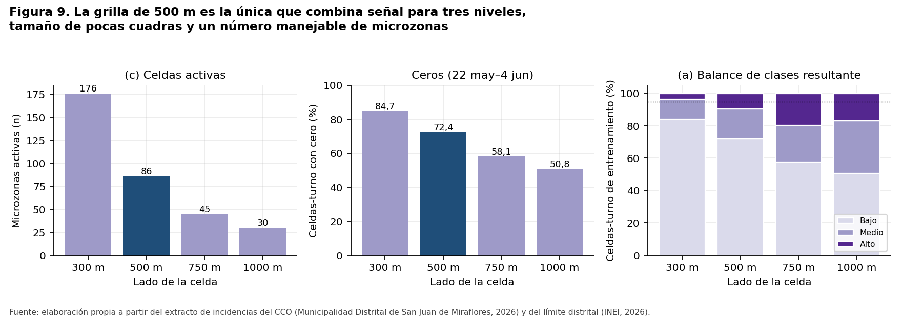

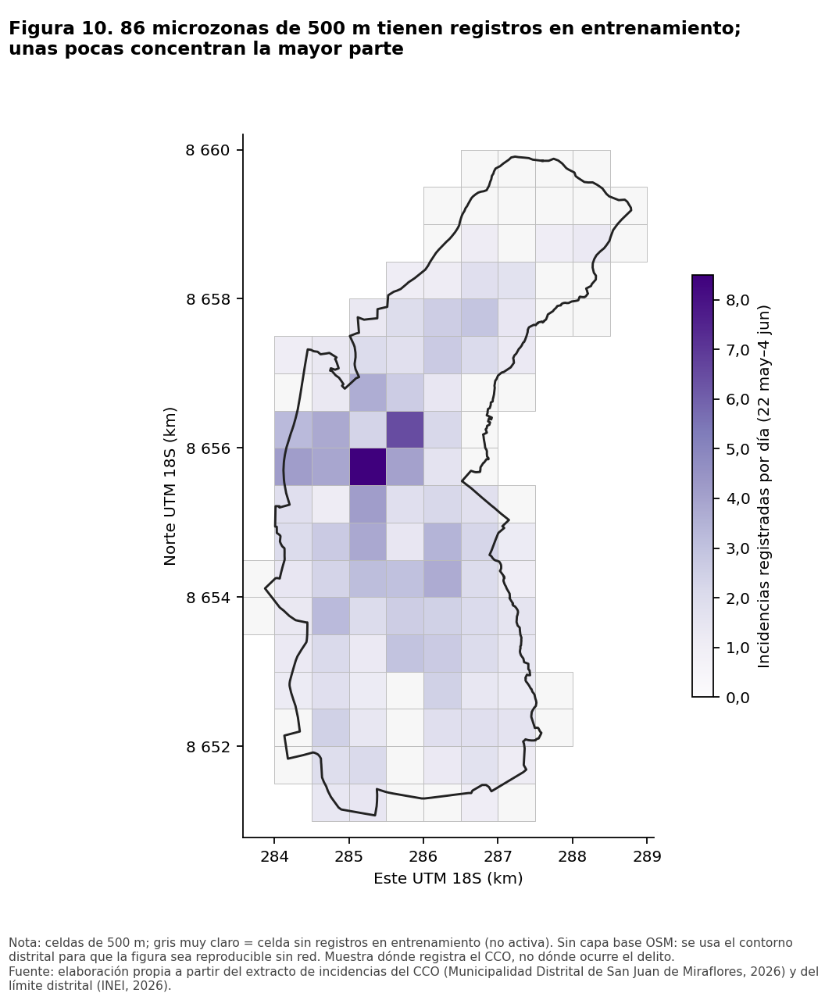

Los mapas se dibujan sobre el contorno distrital, sin capa base OSM, para que las figuras se puedan reproducir sin red. La aplicación de la Fase 3 puede añadir OSM con su atribución.

---

## 5. HE2: concentración espacial

**Hipótesis:** una fracción reducida de las microzonas acumula la mayor parte de los registros.
**Regla de decisión, fijada antes de calcular:** HE2 *se sostiene* si (i) ≤ 20 % de las celdas acumula ≥ 50 % de los registros y (ii) el Gini es ≥ 0,5, y ambas condiciones se cumplen también con 300 y 750 m y por separado en entrenamiento y en validación.
**Universo:** todas las celdas que intersecan el distrito, incluidas las que no tienen registros. Ventana del 22 de mayo al 4 de junio (sin prueba).

| Grilla / periodo | % de celdas con el 50 % | % de celdas con el 80 % | Gini |
|---|---|---|---|
| **500 m, 22 may–4 jun** | **14,0** | **33,1** | **0,63** |
| 500 m, solo entrenamiento | 14,0 | 32,2 | 0,64 |
| 500 m, solo validación | 11,6 | 27,3 | 0,69 |
| 300 m, 22 may–4 jun | 9,4 | 25,7 | 0,72 |
| 750 m, 22 may–4 jun | 14,1 | 32,8 | 0,65 |
| 500 m, solo cámaras | 11,6 | 28,9 | 0,69 |
| 500 m, sin cámaras | 16,5 | 35,5 | 0,60 |

**Resultado: `se_sostiene`** (exploratorio). La ordenación de las celdas es estable: la correlación de Spearman entre entrenamiento y validación es 0,82 y el 10 % superior coincide en un 62 % (8 de 13 celdas). La concentración también aparece en los reportes que no vienen de cámaras (Gini 0,60), lo que sugiere que no es solo un artefacto de su ubicación. Aun así, **es concentración del registro del CCO**, no del delito, y se basa en 14 días.

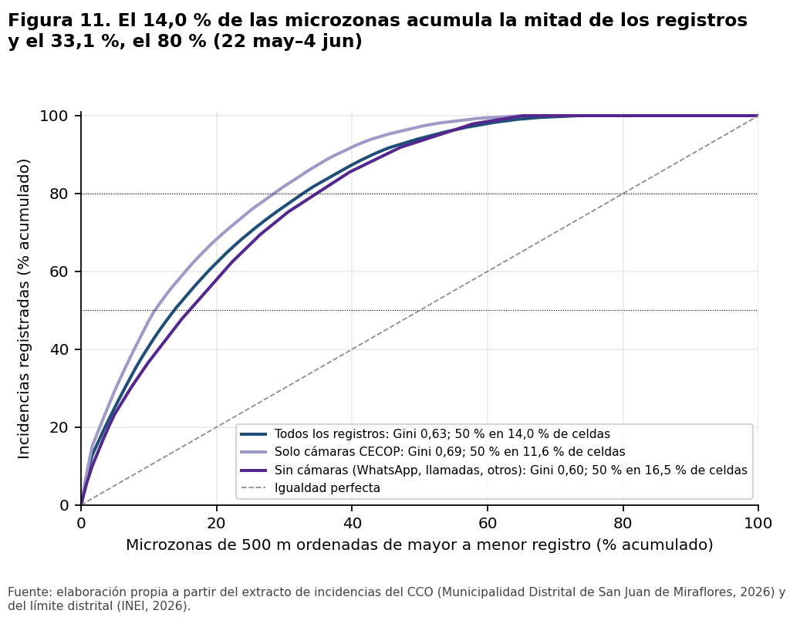

---

## 6. Preparación para el modelado

### 6.1 Partición temporal (contigua, sin solapamiento, días completos)

| Partición | Fechas | Días | Filas |
|---|---|---|---|
| Entrenamiento | 22 may – 31 may | 10 (incluye la semana completa del lunes 25 al domingo 31) | 2 580 |
| Validación | 1 jun – 4 jun | 4 (lun–jue) | 1 032 |
| Prueba | 5 jun – 8 jun | 4 (vie–lun, con el feriado del 7 de junio) | 1 032 |

**Justificación.** Con 18 días utilizables no caben dos semanas completas sin dejar el entrenamiento en 4 días (opción 4/7/7). La opción 7/7/4 da una validación de semana completa, pero deja 7 días de entrenamiento, todos en el tramo de menor cobertura (~99 por día), y de ellos saldrían los umbrales y las celdas activas. La opción elegida (10/4/4) coincide con la propuesta inicial del alcance (unos 4 días de validación y 4 de prueba), maximiza el entrenamiento y deja como prueba los **últimos días completos**. **Coste conocido:** la validación no incluye fin de semana y la prueba sí. La Fase 3 debe reportar métricas por día y por turno. El periodo de prueba no se usó para nada salvo contar filas y clases.

### 6.2 Variable objetivo `nivel`

- `conteo` = incidencias limpias registradas en la microzona activa, la fecha y el turno.
- **b = mediana de los conteos positivos de entrenamiento = 1** (722 conteos positivos: 480 iguales a 1 y 242 de 2 o más).
- **Bajo** si conteo = 0; **Medio** si conteo = 1; **Alto** si conteo ≥ 2.

| Partición | Bajo | Medio | Alto |
|---|---|---|---|
| Entrenamiento | 1 858 (72,0 %) | 480 (18,6 %) | 242 (9,4 %) |
| Validación | 756 (73,3 %) | 172 (16,7 %) | 104 (10,1 %) |
| Prueba (solo conteo) | 686 (66,5 %) | 204 (19,8 %) | 142 (13,8 %) |

El **desbalance** es marcado: en entrenamiento hay 7,7 filas Bajo por cada fila Alto. La proporción de Alto crece hacia el final del periodo, en coherencia con el cambio de cobertura. Por eso se recomienda ponderar las clases y evaluar con Macro F1, que da el mismo peso a las tres.

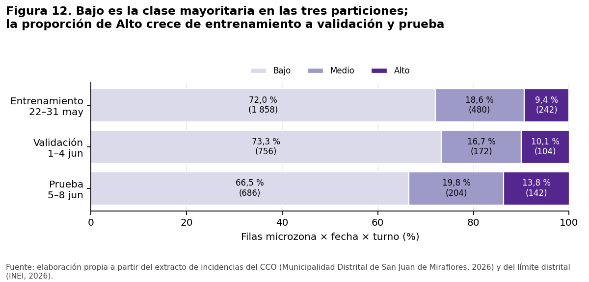

### 6.3 Gravedad G (supuesto de diseño)

Se usa una escala ordinal de 1 a 5 por tipo: actividad presuntamente delictiva **5** > presuntas faltas **4** > presuntas infracciones **3** > infraestructura y riesgo **2** > operativos, ayuda y apoyo, y acontecimientos especiales **1**. `G_norm = (G − 1)/4`. La justificación de cada valor está en `datos/gravedad_por_tipo.csv`. **Es un supuesto del diseño, no una medición**, y no usa la columna `NIVEL` de la fuente, que es [POST].

### 6.4 Variables candidatas sin fuga

La tabla `microzona × fecha × turno` tiene **86 × 18 × 3 = 4 644 filas** (71,1 % con conteo cero) y 18 variables. Todas se calculan con incidencias de fechas **anteriores** a la fecha objetivo, es decir, con la información disponible al cierre del día anterior.

| Grupo | Variables | Ventana |
|---|---|---|
| Historial de la microzona | `lag1_turno`, `lag7_turno`, `suma3_turno`, `media7_turno`, `lag1_celda`, `suma7_celda`, `dias_desde_ultima`, `gravedad_media7_celda`, `nivel_lag1_turno` | d−1, d−7, d−3…d−1, d−7…d−1 |
| Espacial (vecinos) | `vecinos_lag1_turno`, `vecinos_suma7` | d−1, d−7…d−1 |
| Calendario | `dia_semana`, `fin_de_semana`, `feriado`, `turno` | conocido de antemano |
| Contexto del distrito | `distrito_lag1_turno`, `distrito_lag1`, `distrito_media7` | d−1, d−7…d−1 |

En entrenamiento, las variables de historial de la propia celda son las más asociadas al conteo (Spearman de 0,26 a 0,35; `dias_desde_ultima` −0,26), por delante de las de calendario (≤ 0,08). Esto adelanta lo que la Fase 3 contrastará en HE1, aunque no lo prueba. `lag7_turno` está vacío solo el 22 de mayo (258 filas). `feriado` es constante en entrenamiento y validación.

**Auditoría de fuga.** Se excluyen `estado_final`, `fecha_hora_cierre`, `tiempo_respuesta_min` y `NIVEL` (todas [POST]), además de `conteo` y `nivel` (el objetivo). También queda excluido cualquier agregado de la misma fecha-turno o posterior. **Prueba programática:** para cada una de las 18 fechas se recalcularon las variables (1) truncando la historia en la fecha objetivo y (2) inyectando 50 incidencias falsas en esa fecha. En los dos escenarios, las 17 variables comparables coinciden en las 4 644 filas.

### 6.5 Línea base de persistencia (solo validación)

Predice el nivel del **mismo turno del día anterior** en la misma microzona.

| Métrica (validación, 1 032 filas) | Valor |
|---|---|
| **Macro F1** | **0,439** |
| Exactitud | 0,636 |
| F1 Bajo / Medio / Alto | 0,784 / 0,231 / 0,301 |
| Macro F1 por día (1, 2, 3 y 4 jun) | 0,337 / 0,497 / 0,469 / 0,467 |
| Macro F1 por turno (Mañana / Tarde / Noche) | 0,460 / 0,394 / 0,431 |
| Referencia "siempre Bajo" | 0,282 |

La persistencia acierta en Bajo, pero predice como Bajo el 59 % de las filas Medio y el 41 % de las filas Alto (Figura 13). La variación entre días (de 0,34 a 0,50) muestra que, con 4 días, cualquier diferencia de pocas centésimas entre modelos no es concluyente.

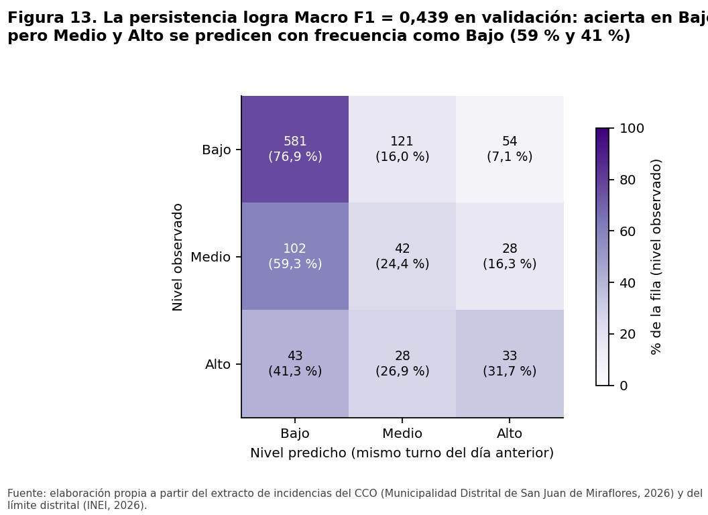

### 6.6 Contexto SIDPOL (no entra al entrenamiento)

Entre enero de 2018 y septiembre de 2026, el SIDPOL registra **90 272 denuncias** en SJM. La cifra anual baja en 2020 (6 760), alcanza su máximo en 2023 (13 623) y cae a 10 383 en 2025. En los últimos 12 meses predominan "otros" (36,6 %) y violencia contra la mujer e integrantes del grupo familiar (35,1 %), seguidos de hurto (13,6 %) y robo (7,1 %). En mayo y junio de 2026 hubo 883 y 818 denuncias, respectivamente. El SIDPOL no tiene ubicación fina ni turno y mide otra cosa (denuncias policiales), así que **solo sitúa el distrito en contexto**.

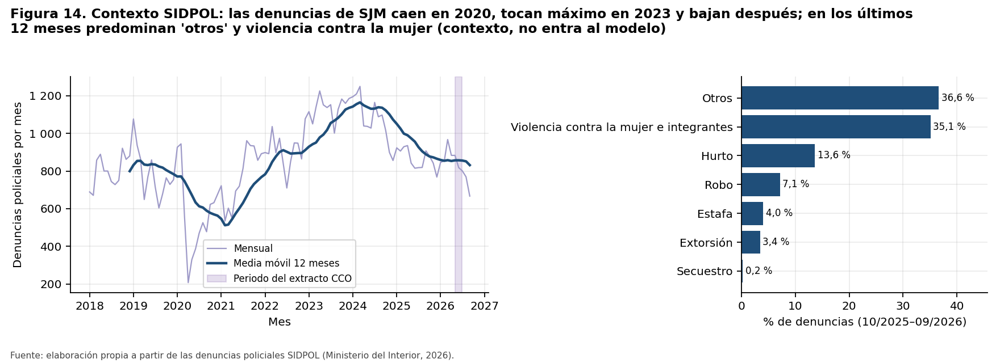

---

## 7. Implicancias para el modelo

- **Qué esperar:** la persistencia ya alcanza 0,439. El antecedente de Wheeler y Steenbeek (2021) sugiere que los modelos de ensamble suelen superar solo ligeramente a un modelo basado en conteos previos. Una mejora pequeña sería un resultado razonable, y la Fase 3 debe reportar si la complejidad aporta algo.
- **Desbalance:** Bajo representa el 72 % y Alto menos del 10 % en entrenamiento. Conviene ponderar las clases y no reportar solo la exactitud.
- **Pocas semanas:** 10 días de entrenamiento y 4 de validación y de prueba. Las métricas tendrán alta varianza; deben darse por día y con intervalos, y presentarse como exploratorias.
- **Cambio de cobertura:** la proporción de Alto crece de entrenamiento (9,4 %) a prueba (13,8 %). Hay riesgo de que el modelo subestime Alto en prueba. Las variables de contexto del distrito ayudan, pero no garantizan nada.
- **Validación sin fin de semana:** un modelo elegido en validación puede comportarse distinto el fin de semana de prueba.
- **Arranque como historial:** los rezagos de las primeras fechas de entrenamiento están subestimados.

---

## 8. Limitaciones y consideraciones éticas

- **Registro, no delito.** El objetivo mide incidencias registradas por el CCO, en su mayoría por cámaras (74,5 %). Un nivel Alto indica que el CCO registra más en esa microzona y turno, no que ocurran más delitos ni que la zona sea peligrosa.
- **Bucle de retroalimentación.** Si el patrullaje se dirige a las microzonas de nivel Alto, allí se registrará más, y el modelo reforzará su propia predicción (Lum e Isaac, 2016). Hay que vigilar la distribución del esfuerzo y no usar el sistema como única guía.
- **Estigmatización.** Los mapas y rankings no deben publicarse como "zonas peligrosas". Deben presentarse como apoyo a una decisión humana, indicando que reflejan registros de un periodo corto y no una condición permanente del lugar.
- **Cobertura y calidad.** Hay 26 días publicados (18 utilizables como objetivo), arranque y censura. Además, el 20,9 % no tiene sector y 32 puntos caen fuera del límite.
- **Sin exposición.** No hay población ni flujo de personas por microzona, así que los conteos no son tasas.
- **Gravedad.** La escala G es un supuesto de diseño revisable, no una medida del daño.
- **Datos personales.** El dataset limpio no contiene datos personales. `direccion` se conserva solo para la ficha de detalle.

---

## 9. Referencias

Chainey, S., Tompson, L., & Uhlig, S. (2008). The utility of hotspot mapping for predicting spatial patterns of crime. *Security Journal, 21*(1-2), 4-28. https://doi.org/10.1057/palgrave.sj.8350066

Instituto Nacional de Estadística e Informática. (2026). *Límites distritales censales (ubigeo 150133)* [Capa geográfica servida por la Autoridad Nacional del Agua]. https://geosnirh.ana.gob.pe/server/rest/services/Hosted/distritos/FeatureServer

Lum, K., & Isaac, W. (2016). To predict and serve? *Significance, 13*(5), 14-19. https://doi.org/10.1111/j.1740-9713.2016.00960.x

Ministerio del Interior. (2026). *Denuncias policiales registradas a nivel nacional, enero 2018 a septiembre 2026* [Conjunto de datos]. Plataforma Nacional de Datos Abiertos. https://www.datosabiertos.gob.pe/dataset/denuncias-policiales-registradas-nivel-nacional-mininter

Municipalidad Distrital de San Juan de Miraflores. (2026). *Relación de incidencias atendidas por el Centro de Control de Operaciones (CCO)* (versión 1.0, corte 2026-06-10) [Conjunto de datos]. Plataforma Nacional de Datos Abiertos. https://www.datosabiertos.gob.pe/dataset/relaci%C3%B3n-de-incidencias-atendidas-por-el-centro-de-control-de-operaciones-cco-municipalidad

Perry, W. L., McInnis, B., Price, C. C., Smith, S. C., & Hollywood, J. S. (2013). *Predictive policing: The role of crime forecasting in law enforcement operations*. RAND Corporation. https://doi.org/10.7249/j.ctt4cgdcz

Scikit-learn developers. (s. f.). *Metrics and scoring: quantifying the quality of predictions*. Documentación técnica oficial. https://scikit-learn.org/stable/modules/model_evaluation.html

Weisburd, D. (2015). The law of crime concentration and the criminology of place. *Criminology, 53*(2), 133-157. https://doi.org/10.1111/1745-9125.12070

Wheeler, A. P., & Steenbeek, W. (2021). Mapping the risk terrain for crime using machine learning. *Journal of Quantitative Criminology, 37*, 445-480. https://doi.org/10.1007/s10940-020-09457-7
