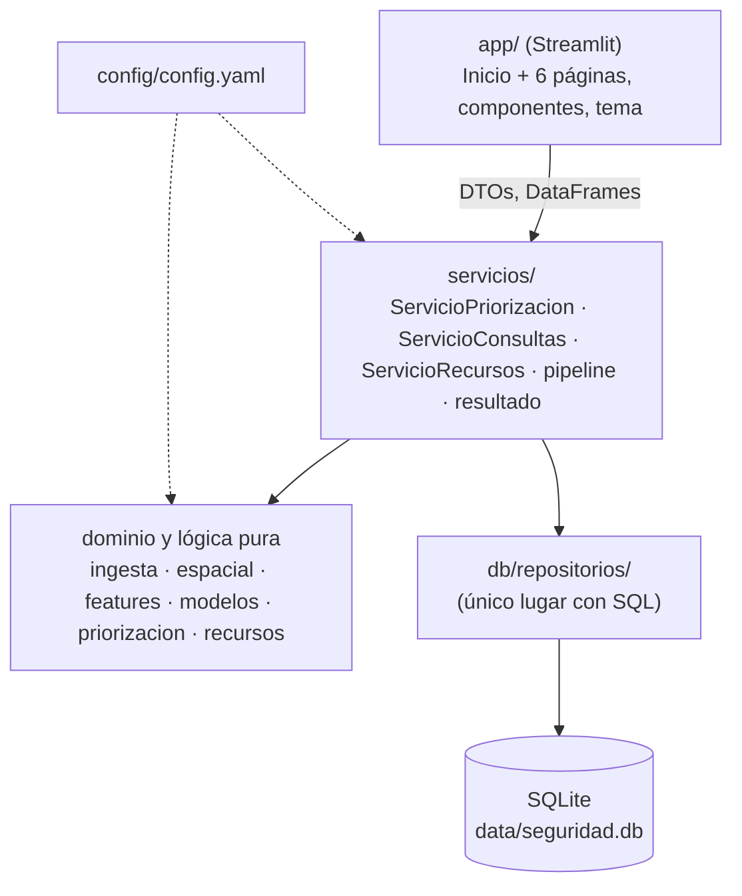
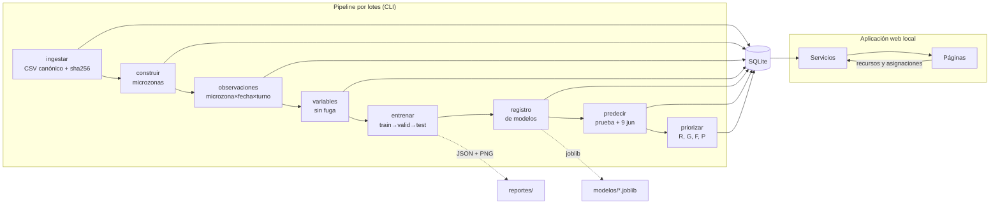
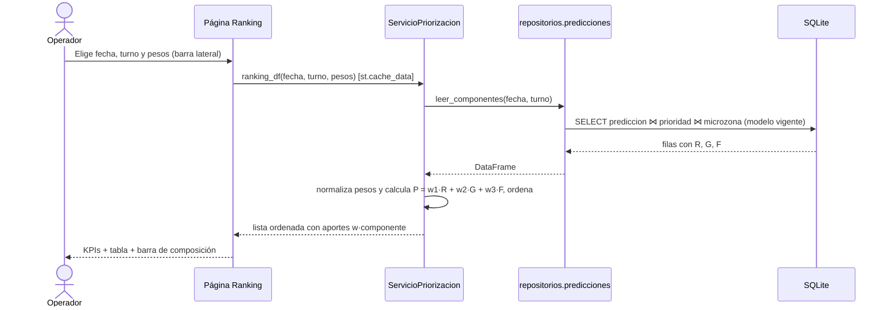

# Arquitectura

El sistema tiene dos partes que comparten una base SQLite local:

1. **Pipeline por lotes (CLI).** `python -m seguridad_ciudadana todo` ingesta el CSV canónico, construye microzonas y variables, entrena y evalúa los modelos, predice y prioriza. Todo lo escribe en `data/seguridad.db`, en `modelos/` (artefactos joblib) y en `reportes/` (métricas JSON y figuras PNG).
2. **Aplicación web local (Streamlit).** `streamlit run app/Inicio.py` **solo lee**. Nunca entrena. La única escritura que hace es la del módulo de recursos (segundo nivel), y la hace a través del servicio correspondiente.

## Capas

Reglas:

- La interfaz importa **solo** `servicios` (y utilidades de formato y dominio sin E/S). No ejecuta SQL ni lee archivos de datos.
- `servicios` orquesta la lógica de dominio y los repositorios. Las funciones de dominio (grilla, variables, métricas, prioridad, reglas de asignación) son puras y se prueban sin base de datos.
- Solo `db/` contiene SQL. Es SQL parametrizado, corre con `PRAGMA foreign_keys = ON` y cada escritura va en una transacción (`BaseDatos.transaccion()`).
- El distrito, las rutas, la partición, los pesos, las semillas y las grillas de hiperparámetros salen de `config/config.yaml`.

## Componentes y flujo de datos

## Flujo de consulta del operador

R, G y F se calculan una sola vez en `priorizar` y se guardan en `prioridad`. Al mover los pesos en la interfaz solo se recombinan esos tres valores, así que el cambio se ve en menos de 2 s.

## Decisiones

Ver `docs/adr/`:

| ADR | Decisión |
|---|---|
| 0001 | Stack Python/Streamlit y arquitectura por capas |
| 0002 | SQLite como persistencia; ampliaciones del modelo de datos |
| 0003 | Microzona, objetivo y variables tomados de la Fase 2; fecha operativa; tratamiento de `lag7_turno` y `feriado` |
| 0004 | Fórmula de priorización y pesos por defecto |
| 0005 | Desviaciones del diseño UX/UI |
| 0006 | Protocolo de evaluación y selección del modelo |
| 0007 | Calibración posterior con validación |

## Requisitos no funcionales (medidos en el equipo de desarrollo)

| Requisito | Meta | Medido |
|---|---|---|
| Pipeline completo | < 5 min | ≈ 1 min (`todo`) |
| Cambio de fecha/turno/pesos | < 2 s | < 1 s (consulta SQLite + recombinación en memoria, con caché) |
| Arranque de la app | < 10 s | ≈ 3–5 s |
| Reproducibilidad | mismas métricas con el mismo dato y la misma config | test `test_reproducibilidad.py`; versión del modelo = hash(datos, config, parámetros) |
| Portabilidad | Windows 10, Python 3.10+, solo pip | sin GeoPandas ni dependencias de compilación |
