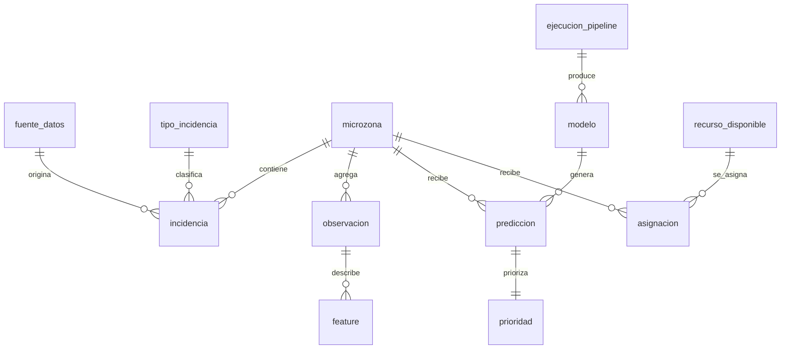

# Modelo de datos (SQLite)

El esquema está en `src/seguridad_ciudadana/db/schema.sql` y su versión se guarda en `PRAGMA user_version` (versión actual: 1). `python -m seguridad_ciudadana init-db` lo crea o lo actualiza, y se puede repetir sin efectos. Las claves foráneas están activas en todas las conexiones.

## Tablas

| Tabla | Filas (corrida actual) | Contenido | Restricciones clave |
|---|---|---|---|
| `fuente_datos` | 1 | Fuente CCO: nombre, institución, URL, licencia, **sha256 del CSV canónico**, fecha de descarga | PK `id` |
| `tipo_incidencia` | 23 | (tipo, subtipo) → `tipo_corto`, `subtipo_norm`, **gravedad 1–5** (supuesto de diseño de la Fase 2) | `UNIQUE(tipo, subtipo)`, `CHECK gravedad BETWEEN 1 AND 5` |
| `microzona` | 121 | Celdas de 500 m que intersecan el distrito: `col`, `fila`, polígono GeoJSON WGS84, centroide, fracción dentro del límite, sector de referencia y `activa` (86) | `UNIQUE(col, fila)`; ids `MZ-0001…MZ-0086` (activas) y `SR-…` (sin registros en entrenamiento) |
| `incidencia` | 2 592 | Un registro de la fuente con coordenadas UTM, celda, `dist_limite_m`, `excluida` (a > 150 m del límite: 12), `periodo` (arranque/estable/censurado) y gravedad. **No guarda las columnas [POST]** | `CHECK turno`, FK a fuente, tipo y microzona |
| `observacion` | 4 902 | Microzona activa × fecha × turno con `conteo`, `nivel` y `particion` (train/valid/test = 4 644 filas; `operativa` = 258 filas del 9 jun sin objetivo) | `UNIQUE(microzona_id, fecha, turno)`, `CHECK turno`, `CHECK particion` |
| `feature` | 88 236 | Variables en formato largo (`observacion_id`, `nombre`, `valor`); `turno` y `nivel_lag1_turno` se guardan como códigos 0–2 | PK `(observacion_id, nombre)`, `ON DELETE CASCADE` |
| `ejecucion_pipeline` | crece | Bitácora de cada comando: inicio, fin, estado (`ok`/`error`) y resumen JSON | `CHECK estado` |
| `modelo` | 4 por configuración | Registro: nombre, **versión** (hash de datos, config y parámetros), hiperparámetros, sha256 del dato, hash y copia de la config, **métricas JSON** (valid y test, por clase, por día, por turno, bootstrap e importancia), ruta del artefacto, `vigente` | `UNIQUE(nombre, version)`; índice único parcial: **un solo vigente** |
| `prediccion` | 1 290 | Modelo vigente × microzona × fecha × turno: nivel y probabilidades; `tipo_fecha` = `demostracion` (5–8 jun) u `operativa` (9 jun) | `UNIQUE(modelo_id, microzona_id, fecha, turno)`, probabilidades en [0, 1] |
| `prioridad` | 1 290 | R, G, F, pesos por defecto, P y posición | todos en [0, 1], `posicion >= 1` |
| `recurso_disponible` | usuario | Recursos ilustrativos por fecha, turno y tipo | `UNIQUE(fecha, turno, tipo)`, `CHECK cantidad >= 0`, trigger: no puede bajar de lo ya asignado |
| `asignacion` | usuario | Recurso → microzona con cantidad | `CHECK cantidad > 0`; **trigger `tg_asignacion_no_excede`**: la suma asignada no puede superar lo disponible |

## Ampliaciones respecto del diseño (§5.4)

Registradas en el ADR 0002:

- `microzona` guarda también las celdas sin registros (`activa = 0`, prefijo `SR-`), para pintarlas en gris en el mapa ("Sin registros en el periodo"), y los índices `col` y `fila`.
- `incidencia` guarda las marcas de limpieza (`excluida`, `periodo`, `dist_limite_m`) y la gravedad. Así la limpieza queda trazable sin borrar registros.
- `observacion` admite `particion = 'operativa'`, con `conteo` y `nivel` nulos para la fecha futura.
- `modelo` añade `sha256_datos`, `config_hash`, `config`, `metricas`, `macro_f1_test` y `ejecucion_id`, que dan trazabilidad completa.
- `prediccion.tipo_fecha` distingue la demostración (fechas de prueba) de la fecha operativa.
- Hay dos triggers de defensa en profundidad para los recursos. El servicio valida primero y devuelve un mensaje legible para el operador.

## Idempotencia

| Paso | Estrategia |
|---|---|
| `ingestar` | upsert de `fuente_datos` y `tipo_incidencia`; `DELETE` + `INSERT` de `incidencia`, que ninguna otra tabla referencia |
| `construir` | upsert de `microzona`, para no romper asignaciones existentes; reemplazo de `observacion` y `feature` |
| `entrenar` | upsert de `modelo` por `(nombre, version)`: con los mismos datos, config y parámetros se obtiene la misma versión y no se duplica |
| `predecir` / `priorizar` | reemplazo completo de `prediccion` y `prioridad` |
| recursos | no los toca el pipeline (son datos del usuario) |
